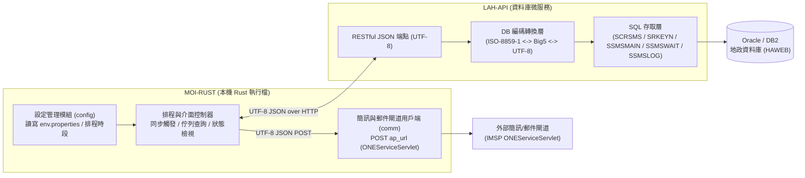

# LAH-API 與 MOI-RUST 介面整合規格書（SPEC）

> **目標讀者**：負責實作 `LAH-API`（資料庫存取服務端）與 `MOI-RUST`（排程、設定與簡訊／郵件派送用戶端）的開發 Agent。  
> **架構核心決策**：`MOI-RUST` **不直接連線 Oracle / DB2 資料庫**；所有資料庫連線、SQL 查詢／異動與資料庫層 `ISO-8859-1` ↔ `Big5` 轉碼皆收斂至 `LAH-API`，雙方透過標準 **UTF-8 JSON over HTTP REST API** 通訊。

---

## 1. Problem Statement（問題陳述）

既有地政簡訊與郵件通知系統由兩支獨立的舊版 Java 程式（`MOI_EX.exe` 與 `SMS.exe`）組成，各自內嵌老舊的 JDBC 驅動並直接讀寫地政資料庫（`HAWEB`），且資料庫中文欄位以 `ISO-8859-1` 存放 `Big5` 位元組，導致：
1. 每個前端或批次工具都必須攜帶龐大的 JDBC 驅動與資料庫帳密（`oUrl`、`oUser`、`oPwd`）。
2. 複雜的多表關聯 SQL（共 8 組收件／異動查詢與 3 張佇列表狀態轉移）散落在桌面端與批次端，難以維護與測試。
3. 欲將本機執行檔改寫為輕量、免安裝 JRE 的 Rust 程式（`MOI-RUST`）時，若在 Rust 端直接綁定 Oracle OCI 驅動會大幅增加部署複雜度。

---

## 2. Solution（解決方案與責任邊界）

將系統拆分為「資料服務層（`LAH-API`）」與「排程設定及派送端（`MOI-RUST`）」，以單一清晰的 HTTP JSON 介面（Seam）解耦：



### 責任劃分
1. **`LAH-API`（伺服器端）**：
   - 集中管理資料庫連線池與憑證。
   - 封裝原 `MOIEx` 的案件偵測與去重入列 SQL，以及原 `SmsMainFrame` 的佇列搬移、待發送查詢、成功紀錄（`SSMSLOG`）與失敗重試遞增（`SSMSWAIT.MS32`）SQL。
   - **統一負責資料庫欄位的 `ISO-8859-1` ↔ `Big5` 轉換**，對外 API 一律收發標準 **UTF-8 JSON**。
2. **`MOI-RUST`（用戶端）**：
   - 管理本機設定檔（`env.properties`）與排程時段（`search_time`、`resend_time`、`start_hours`～`end_hours`）。
   - 提供 CLI／GUI 介面供檢視三張表狀態（`SSMSMAIN`、`SSMSWAIT`、`SSMSLOG`）與手動／定時觸發作業。
   - 呼叫 `LAH-API` 取得待發送清單後，組裝 Payload 呼叫外部簡訊／郵件閘道 `ap_url`（`ONEServiceServlet`），再呼叫 `LAH-API` 回報發送結果（成功或失敗重試）。

---

## 3. User Stories（使用者故事）

1. **作為排程執行器（`MOI-RUST`）**，我希望能呼叫 `LAH-API` 觸發「當日案件掃描與入列（原 `MOIEx` 邏輯）」，讓符合「地籍異動即時通（一般民眾）」與「機關通報（工輔法）」的新案件在完成三表（`SSMSMAIN`、`SSMSWAIT`、`SSMSLOG`）去重後寫入 `SSMSMAIN`，並回傳本次新增筆數。
2. **作為排程執行器（`MOI-RUST`）**，我希望能呼叫 `LAH-API` 觸發「待處理佇列搬移（原 `TTSearchTimer` 邏輯）」，將 `SSMSMAIN` 中待處理的紀錄搬移至 `SSMSWAIT`（初始重試次數 `MS32 = '0'`）並自 `SSMSMAIN` 移除。
3. **作為排程執行器（`MOI-RUST`）**，我希望能從 `LAH-API` 查詢目前 `SSMSWAIT` 中的待發送項目清單（已由 `LAH-API` 完成代碼表 `SRKEYN`、`SSYSAUTH1`、`ssms_govinfo_m` 關聯與 UTF-8 轉碼，並組裝好 `site_id`、`subject` 與 `msg`），以便直接送往簡訊／郵件閘道。
4. **作為排程執行器（`MOI-RUST`）**，當一筆通知經由 `ap_url` 閘道發送成功（`code == "1"`）時，我希望能呼叫 `LAH-API` 的「回報發送結果」端點，由 `LAH-API` 在單一交易內寫入 `SSMSLOG`（`MS31 = 'S'`）並刪除 `SSMSWAIT` 對應紀錄。
5. **作為排程執行器（`MOI-RUST`）**，當一筆通知發送失敗時，我希望能呼叫 `LAH-API` 的「回報發送結果」端點並傳入最大重試次數 `max_retries`（對應 `resend_time`）：若 `MS32 < max_retries` 則將 `SSMSWAIT.MS32` 加 1；若已達上限則寫入 `SSMSLOG`（`MS31 = 'F'`）並自 `SSMSWAIT` 移除。
6. **作為現場管理人員（透過 `MOI-RUST` 查詢介面）**，我希望能分頁或依條件查詢 `SSMSMAIN`（主佇列）、`SSMSWAIT`（待傳佇列）與 `SSMSLOG`（歷史紀錄）的清單與中文狀態說明，以取代舊版 `SmsMainFrame` 的三個 `JTable` 分頁（`rebuildMainTable`、`rebuildWAITTable`、`rebuildLOGTable`）。
7. **作為現場管理人員（透過 `MOI-RUST` 設定介面）**，我希望能檢視並修改本機 `env.properties` 中的 `lah_api_url`、`ap_url`、郵件發送參數與排程時間，並發送測試簡訊／測試信件以驗證設定是否正確。

---

## 4. Implementation Decisions（實作決策與 API 契約）

### 4.1 編碼與資料型別邊界決策
- **資料庫編碼封裝於 `LAH-API`**：地政資料庫內的中文欄位（如 `SRKEYN.KCNT`、`SSMS_USERINFO_M.LNAM`、`SSMSMAIN.MS_NOTE` 等）以 `ISO-8859-1` 存放 `Big5` 位元組。`LAH-API` 讀取 DB 時必須執行 `ISO-8859-1 -> Big5 -> UTF-8`，寫入 DB（如 `MS_NOTE`）前必須執行 `UTF-8 -> Big5 -> ISO-8859-1`。
- **民國日期與時間格式**：所有資料庫日期欄位（`MS07_1`、`RM07_1`、`RM56_1`）均為 7 碼民國年月日字串 `YYYMMDD`（例：`1151113`），時間欄位（`MS07_2`）為 6 碼 `HHMMSS`（例：`093000`）。

### 4.2 核心複合主鍵識別（`RecordIdentity`）
由於舊表無單一自增主鍵，`SSMSMAIN`、`SSMSWAIT`、`SSMSLOG` 皆以複合欄位定址一筆通知紀錄。所有狀態更新／刪除 API 統一使用以下 JSON 結構識別目標紀錄：

```json
{
  "ms03": "115",
  "ms04_1": "HA01",
  "ms04_2": "001230",
  "ms30": "Y",
  "ms_type": "M",
  "ms14": "0912345678",
  "ms_mail": "",
  "gov_ext": {
    "app_seq": "1",
    "app_id": "GOV01",
    "gov_id": "A123",
    "cc00": "C",
    "cc48": "0101",
    "cc49": "00010000",
    "gov_oid": "2.16.886.101"
  }
}
```
- **一般案件（`ms30` 為 `'Y'`、`'Z'`、`'I'`、`'C'`、`'D'`、`'F'` 等）**：`gov_ext` 為 `null`，以 `(ms03, ms04_1, ms04_2, ms30, ms_type)` 加上 `ms14`（當發送簡訊時）或 `ms_mail`（當發送 Email 時）作為 `WHERE` 條件。
- **機關通報案件（`ms30` 為 `'y'` 或 `'z'`）**：`gov_ext` 必填，需額外比對 `APP_ID`、`NVL(GOV_ID,'X')`、`CC00`、`CC48`、`CC49`、`APP_SEQ`、`NVL(GOV_OID,'X')`（對應原 `SmsMainFrame.UpdSmswait` / `DelSmsWait` 14 參數多載版本）。

---

### 4.3 `LAH-API` REST 端點規格

#### 端點 1：獲取系統代碼與站台資訊
- **方法與路徑**：`GET /api/v1/sms/metadata`
- **用途**：取得 `SRKEYN` 中的站台代碼與名稱（供 `MOI-RUST` 快取並帶入簡訊閘道 `siteID`）。
- **對應 SQL**：
  - `site_id`：`SELECT KRMK FROM SRKEYN WHERE KCDE_1='55' AND KCDE_2='01'`
  - `office_name`：`SELECT KCNT FROM SRKEYN WHERE KCDE_1='55' AND KCDE_2='01'`
  - `county_name`：`SELECT KCNT FROM SRKEYN WHERE KCDE_1='66' AND KCDE_2='01'`
- **回應範例（`200 OK`）**：
  ```json
  {
    "site_id": "HA",
    "office_name": "桃園地政事務所",
    "county_name": "桃園市"
  }
  ```

#### 端點 2：觸發案件掃描與入列（原 `MOIEx.main`）
- **方法與路徑**：`POST /api/v1/sms/cases/sync`
- **請求內容**：
  ```json
  {
    "target_date_yyy_mm_dd": "1151113"
  }
  ```
  （若省略 `target_date_yyy_mm_dd`，預設使用伺服器當日民國日期 `YYYMMDD`）。
- **伺服器端行為（`LAH-API`）**：
  1. 執行原 `MOIEx.queryCaseInfo` 的 6 組 SQL（`SQL_A` 至 `SQL_F`：涵蓋 `SCRSMS`、`SCRSMS_RM1821`、`trindx`、`srsindx`、`SRBLOW`、`SREBOW` 與 `SSMS_USERINFO_M`），並依原 `MOIEx.CheckData` 邏輯檢查 `SSMSMAIN`、`SSMSWAIT`、`SSMSLOG` 無重複後寫入 `SSMSMAIN`。
  2. 執行原 `MOIEx.queryGCaseInfo` 的 2 組機關案件 SQL（`SQL_A` 收件 `'y'`、`SQL_C` 異動完成 `'z'`），並依 `MOIEx.CheckGData` 檢查三表無重複後（依 `;` 拆解多組 Email）寫入 `SSMSMAIN`。
- **回應範例（`200 OK`）**：
  ```json
  {
    "target_date": "1151113",
    "user_cases_scanned": 42,
    "user_notifications_inserted": 15,
    "gov_cases_scanned": 8,
    "gov_notifications_inserted": 3
  }
  ```

#### 端點 3：將 `SSMSMAIN` 搬移至 `SSMSWAIT`（原 `SmsMainFrame.TTSearchTimer`）
- **方法與路徑**：`POST /api/v1/sms/queue/enqueue`
- **請求內容**：
  ```json
  {
    "check_register_a": true,
    "check_register_b": true,
    "check_register_c": true,
    "check_register_d": true
  }
  ```
- **伺服器端行為（`LAH-API`）**：
  - 查詢 `SELECT * FROM SSMSMAIN WHERE MS_TYPE='M' ORDER BY MS07_1, MS07_2`（以及相容 `MS_TYPE` 為 `'R'`、`'S'`、`'2'` 之既有邏輯）。
  - 在單一資料庫交易中寫入 `SSMSWAIT`（將 `MS07_1`、`MS07_2` 設為搬移當下之民國日期與時間，`MS32` 設為 `'0'`），並更新或刪除 `SSMSMAIN` 對應紀錄。
- **回應範例（`200 OK`）**：
  ```json
  {
    "moved_to_wait_count": 18,
    "deleted_from_main_count": 18
  }
  ```

#### 端點 4：查詢 `SSMSWAIT` 待發送任務清單（原 `SmsMainFrame.TTSendTimer` 前半段）
- **方法與路徑**：`GET /api/v1/sms/queue/pending`
- **伺服器端行為（`LAH-API`）**：
  - 查詢 `SELECT * FROM SSMSWAIT WHERE MS_TYPE IN ('M','W','O') ORDER BY MS07_1, MS07_2`。
  - 依據 `MS_TYPE` 與 `MS30` 規則（原 `SmsMainFrame.java:640-718`，包含查詢 `SRKEYN`、`SCMSDS`、`SSYSAUTH1`、`ssms_govinfo_m.email_sub`）組裝好最終 UTF-8 的 `subject` 與 `msg`，連同 `site_id` 一併回傳給 `MOI-RUST`。
- **回應範例（`200 OK`）**：
  ```json
  {
    "site_id": "HA",
    "items": [
      {
        "identity": {
          "ms03": "115",
          "ms04_1": "HA01",
          "ms04_2": "001230",
          "ms30": "Y",
          "ms_type": "M",
          "ms14": "0912345678",
          "ms_mail": "",
          "gov_ext": null
        },
        "retry_count": 0,
        "channel": "sms",
        "recipient": "0912345678",
        "subject": "有關您所持有不動產地籍異動1事",
        "msg": " 異動即時通-115年桃資字001230號買賣案已於115年11月13日完成收件，如有疑義請向地政事務所洽詢。"
      }
    ]
  }
  ```

#### 端點 5：回報單筆派送結果（原 `InsSmsLog` / `DelSmsWait` / `UpdSmswait`）
- **方法與路徑**：`POST /api/v1/sms/queue/report`
- **請求內容**：
  ```json
  {
    "identity": {
      "ms03": "115",
      "ms04_1": "HA01",
      "ms04_2": "001230",
      "ms30": "Y",
      "ms_type": "M",
      "ms14": "0912345678",
      "ms_mail": "",
      "gov_ext": null
    },
    "success": true,
    "msg": " 異動即時通-115年...",
    "max_retries": 3,
    "error_desc": null
  }
  ```
- **伺服器端行為（`LAH-API`）**：
  - 若 `success == true`：執行 `InsSmsLog("S", ...)` 寫入 `SSMSLOG`，並執行 `DelSmsWait(...)` 從 `SSMSWAIT` 刪除該筆紀錄；回傳 `"action": "logged_success_and_removed"`。
  - 若 `success == false`：查詢 `SSMSWAIT.MS32`：
    - 若 `MS32 < max_retries`：將 `MS32` 加 1 更新回 `SSMSWAIT`；回傳 `"action": "retry_incremented"`。
    - 若 `MS32 >= max_retries`：執行 `InsSmsLog("F", ...)` 寫入 `SSMSLOG`，並執行 `DelSmsWait(...)` 從 `SSMSWAIT` 刪除；回傳 `"action": "logged_failure_and_removed"`。

#### 端點 6：提供管理介面查詢三表紀錄（原 `rebuildMainTable` / `rebuildWAITTable` / `rebuildLOGTable`）
- **方法與路徑**：`GET /api/v1/sms/records?table={main|wait|log}&limit=200`
- **用途**：供 `MOI-RUST` 的查詢介面顯示目前待處理、待傳送與歷史傳送結果（含代碼對應之中文名稱，如 `Y -> 產權收件通知`、`Z -> 產權異動完成通知`、`S -> 成功`、`F -> 失敗`）。

---

### 4.4 `MOI-RUST` 用戶端模組設計決策
1. **`config` 模組擴充**：
   - 在 `env.properties` 支援新增 `lah_api_url`（明文或 Base64 皆相容，例如 `http://127.0.0.1:8080/api/v1/sms`）；在完全遷移至 `LAH-API` 後，`oUrl`/`oUser`/`oPwd` 在 `MOI-RUST` 端降級為選填（Optional），僅保留 `ap_url`、`ap_userid`、`ap_pwd`、郵件參數與排程參數為必填。
2. **`lah_client` 模組（新增）**：
   - 封裝對 `LAH-API` 上述 6 個端點的呼叫（共用現有 `HttpTransport` trait，便於離線單元測試）。
3. **`comm` 模組修正對齊實測規格**：
   - 將 `send_new_msg` 的 JSON 結構精確對齊 `SmsMainFrame.SendNewMsg`：
     - 簡訊模式（`method: "m"`）：`{"siteID", "method": "m", "to", "msg", "sms_userid", "sms_pwd"}`
     - 郵件模式（`method: "e"`）：`{"siteID", "method": "e", "subject", "to", "msg", "mail_acct", "mail_pwd", "mail_from", "username"}`
   - 解析回應 JSON `{"code": "1", "desc": "..."}`，僅當 `code == "1"` 時視為成功。
4. **`scheduler` / CLI 介面模組（新增）**：
   - 提供命令列子命令或互動選單：
     - `sync`：單次執行案件掃描入列（取代舊 `MOI_EX.exe`）。
     - `daemon`：依 `search_time` 與 `resend_time` 及 `start_hours`～`end_hours` 時段背景執行搬移與派送（取代舊 `SMS.exe` 排程）。
     - `status`：查詢 `main` / `wait` / `log` 三表狀態。
     - `config`：檢視與測試 `env.properties` 設定。

---

## 5. Testing Decisions（測試決策與測試接縫 Seam）

### 5.1 什麼是好測試
- 只測試模組對外的公開行為與契約（HTTP 請求 Payload、回應狀態機、錯誤邊界），不綁定內部私有函式細節。

### 5.2 測試接縫（Seams）
1. **`MOI-RUST` 端唯一外部接縫：`HttpTransport` Trait**：
   - `LahApiClient`（對 `LAH-API`）與 `SmsGatewayClient`（對 `ap_url` 簡訊閘道）皆透過 `HttpTransport` 注入。
   - 單元測試與整合測試透過假物件（Fake/Mock Transport）驗證：
     - 「同步 -> 搬移 -> 拉取待發送 -> 呼叫簡訊／郵件閘道（驗證 `method: "m"` 與 `"e"` JSON 欄位）-> 回報成功或失敗重試」完整生命週期。
     - 當簡訊閘道回傳 `{"code": "0", "desc": "餘額不足"}` 或 HTTP 逾時時，`MOI-RUST` 必定對 `LAH-API` 送出 `success: false` 的回報請求。
2. **`LAH-API` 端測試接縫**：
   - 在 `LAH-API` 專案中，以 HTTP Controller 層（搭配測試用 SQLite / H2 或 Repository Fake）驗證三表去重邏輯（`SSMSMAIN` / `SSMSWAIT` / `SSMSLOG` 任一存在即不重複新增）、`MS32` 重試次數遞增至 `max_retries` 轉入 `SSMSLOG(MS31='F')` 的狀態轉移，以及 `ISO-8859-1` ↔ `Big5` 編碼轉換。

---

## 6. Out of Scope（不在本次範圍）

1. 舊版 `DeleteTempDir`（清理 `c:/Documents and Settings`）功能不再移植。
2. 舊版 `util.Database`（讀取 `TPCEx.properties`）與未使用之 `tw.com.chttl.*` 憑證套件不再移植。
3. 地政資料庫既有 Schema（`SSMSMAIN`、`SSMSWAIT`、`SSMSLOG`、`SCRSMS`、`SRKEYN`）不做任何 DDL 變更，保持 100% 向下相容。

---

## 7. Handoff 與後續 Agent 建議技能（Suggested Skills）

當您將本規格書交給負責 `LAH-API` 或 `MOI-RUST` 的下一個 Agent 工作階段時：
- **參考原始證據檔案**：
  - 反編譯之 SQL 實作細節：[MOIEx.java](file:///D:/DEV/MOI-RUST/moiexe/decompiled_src/MOI_EX/MOIEx.java)、[SmsMainFrame.java](file:///D:/DEV/MOI-RUST/moiexe/decompiled_src/SMS/sms/SmsMainFrame.java)
  - 既有逆向分析報告：[SPEC.md](file:///C:/Users/HA10013859/.gemini/antigravity/brain/b52db87f-58b9-4f5f-85cd-d76c12a15f64/SPEC.md)
  - 已完成之 Rust 基礎模組：[config.rs](file:///D:/DEV/MOI-RUST/src/config.rs)、[encoding.rs](file:///D:/DEV/MOI-RUST/src/encoding.rs)、[comm.rs](file:///D:/DEV/MOI-RUST/src/comm.rs)
- **建議下一個 Agent 呼叫的技能（Suggested Skills）**：
  1. **`/to-tickets`**：讀取本 `LAH_API_SPEC.md`，將 `LAH-API` 端點與 `MOI-RUST` 用戶端拆分為具相依順序的 Tracer-Bullet 票券（Tickets）。
  2. **`/implement`**（內部驅動 **`/tdd`** 與 **`/code-review`**）：依序以紅-綠-重構（Red-Green-Refactor）實作每張票券並審查是否符合本規格書。
